# GWONT Upload

An iOS Shortcut that uploads the Travian page you have open in Safari to [GWONT](https://www.gwont.com), the same way the GWONT browser extension does on a computer.

You run it from Safari's share sheet. It does nothing on its own.

## What it does

1. Checks that the page's address ends in `.travian.com`. On any other page it shows "Not a Travian page" and stops without reading the page.
2. Reads the page's HTML, its address, and your player name from the sidebar.
3. Compresses the HTML (gzip) on iOS 16.4 and later.
4. Sends it in one request to `https://api.gwont.com/export-page`, signed with your GWONT API key.
5. Shows GWONT's reply in a notification.

It does not read cookies, saved passwords or other tabs, it does not change the page, and it contacts no host other than `api.gwont.com`.

The shortcut is in this repository as a [signed file](https://github.com/frodeflem/gwont-ios-shortcut/raw/main/GWONT%20Upload.shortcut), or available at [GWONT Upload on iCloud](https://www.icloud.com/shortcuts/72374e61a26e421e9de0295046de1329).

## Requirements

- iPhone or iPad on iOS 15 or later, using Safari
- A GWONT account

## Setup

Do these steps on your iPhone or iPad.

1. Create an API key on gwont.com under Settings → Account. Give it a name, tap Create key, then copy the key.

   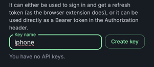 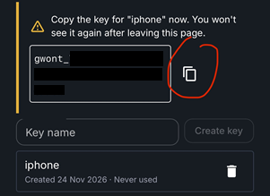

2. Open [GWONT Upload on iCloud](https://www.icloud.com/shortcuts/72374e61a26e421e9de0295046de1329), tap Add Shortcut, and paste the key when it asks.

   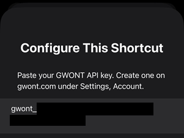

3. Turn on Allow Running Scripts: Settings → Apps → Shortcuts → Advanced (on iOS 17 and earlier: Settings → Shortcuts → Advanced). You may be prompted about this when you set up the Shortcut.

   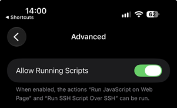

4. Open a Travian page in Safari, tap the page menu button to the left of the address, tap Share, and choose GWONT Upload.

   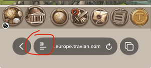 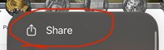

5. The first time, iOS asks whether the shortcut may access the page and connect to `api.gwont.com`. Allow both.
6. On success, GWONT's reply appears in a notification looking like this:

   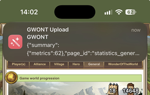

### Putting the shortcut at the top of the share sheet

GWONT Upload starts at the bottom of the share sheet's list. To make it a favourite:

1. In the share sheet, scroll down and tap Edit Actions.

   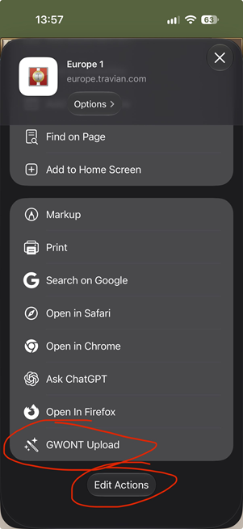

2. Tap the green plus next to GWONT Upload.

   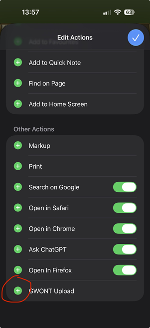

3. Tap the check mark to save.

   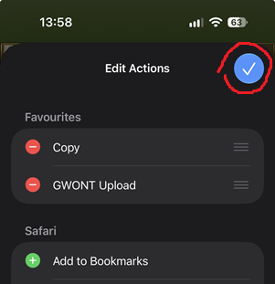

GWONT Upload then appears in the row of actions near the top of the share sheet.

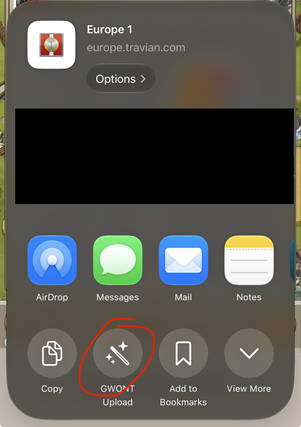

### Troubleshooting

If you skip the Allow Running Scripts setting, the shortcut stops with "Could not run Run JavaScript on Web Page".

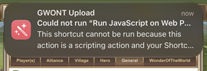

Open the shortcut in the Shortcuts app and tap Open Settings to get to the setting.

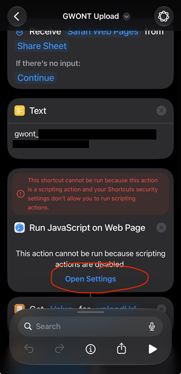

## Verifying the Shortcut yourself

Everything the shortcut does is visible. Open it in the Shortcuts editor and compare it with this list:

| #   | Step                       | What to expect                                                                   |
| --- | -------------------------- | -------------------------------------------------------------------------------- |
| 1   | Text                       | Your API key                                                                     |
| 2   | Run JavaScript on Web Page | The script in `SCRAPE_PAGE_JAVASCRIPT` in [build_shortcut.py](build_shortcut.py) |
| 3   | Get Dictionary Value       | `rejection`                                                                      |
| 4   | If                         | Dictionary Value has any value                                                   |
| 5   | Show Alert                 | "Not a Travian page"                                                             |
| 6   | Stop This Shortcut         |                                                                                  |
| 7   | Otherwise                  | Empty                                                                            |
| 8   | End If                     |                                                                                  |
| 9   | Get Dictionary Value       | `uploadUrl`                                                                      |
| 10  | Get Dictionary Value       | `contentEncoding`                                                                |
| 11  | Get Dictionary Value       | `bodyBase64`                                                                     |
| 12  | Base64 Decode              |                                                                                  |
| 13  | Get Contents of URL        | POST to the upload URL, with `Authorization` and `Content-Encoding` headers      |
| 14  | Show Notification          | GWONT's reply                                                                    |

If your copy has other steps, contacts another host, or its script mentions `document.cookie`, `localStorage`, `fetch` or `XMLHttpRequest`, it is not the shortcut built from this repository.

iOS also keeps its own record: the Privacy tab in the shortcut's details lists the sites it has been allowed to reach.

## Good to know

- The whole page is uploaded, so GWONT receives everything shown on it.
- Your API key is stored in the shortcut as plain text. Use a key made for this, and delete it on gwont.com if you stop using the shortcut.
- A copy you have added never updates itself.
- On the farm list page the shortcut uploads the lists as they were when the page loaded. The browser extension reads the current ones.

## Building it from source

[build_shortcut.py](build_shortcut.py) writes the shortcut file. It needs Python 3 and nothing else.

```sh
python build_shortcut.py
```

iOS only imports signed shortcuts. Sign the file on a Mac, then open the signed file to add it:

```sh
shortcuts sign --mode anyone --input gwont-upload.unsigned.shortcut --output "GWONT Upload.shortcut"
```
